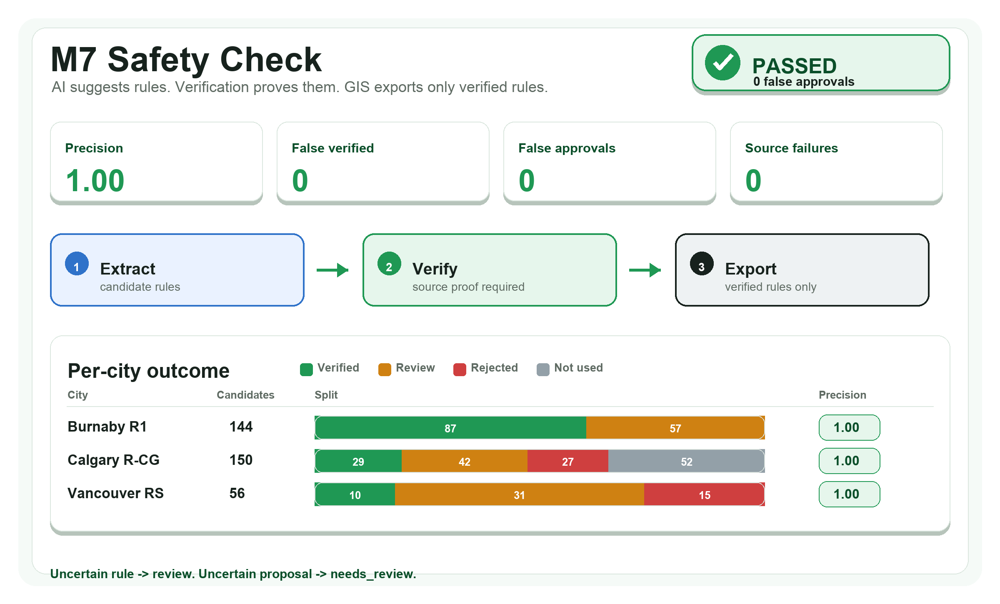

# Bylaw rule verification

Turns municipal zoning bylaw PDFs into source-checked rules for planners and GIS
teams: an LLM proposes rules, and a deterministic verifier promotes only the ones
the bylaw text actually supports.

<!-- result:start -->
**Result (measured 2026-11-18):** 126 rules verified across Burnaby, Calgary and Vancouver with verified precision 1.00 and 0 false-verified rules against the gold benchmarks.
In the safety benchmark all 34 poisoned cases and 3 poisoned evidence bundles are blocked. Offline, no model call (`make eval`).
<!-- result:end -->



**See it:** `make setup && make demo`, then open http://localhost:8631. No account,
no API key, no cost.

This began as a client-sponsored UBC Master of Data Science capstone for Green
Metrics Technology, built by a four-person team. Thomas (Yusen) Rong led
verification. "F1" is his own continuation of the work after the capstone.

## Results

<!-- results:start -->
| City | Candidates | Verified | Review | Verified precision | False verified | Coverage recall | Poisoned inputs blocked |
|---|---:|---:|---:|---:|---:|---:|---:|
| Burnaby R1 | 144 | 87 | 57 | 1.00 | 0 | 0.975 | 27 of 27 |
| Calgary R-CG | 150 | 29 | 42 | 1.00 | 0 | 1.000 | 6 of 6 |
| Vancouver RS | 56 | 10 | 31 | 1.00 | 0 | 1.000 | 4 of 4 |
<!-- results:end -->

Generated by `make docs` from [outputs/eval_summary.json](outputs/eval_summary.json),
which `make eval` builds offline from the committed M7 run artifacts in
`outputs/m7_runs/` (restored byte-for-byte from the dashboard repo; see
[MANIFEST.sha256](outputs/m7_runs/MANIFEST.sha256)) and the poisoned cases in
`benchmark/gold/`. "Poisoned inputs" are candidates or evidence bundles built to
be wrong; every one must stay unverified. `make check-docs` fails when this
table and the summary differ.

## How it works

```text
Extraction proposes.  Verification proves.  GIS consumes only verified rules.
```

Every candidate field (object, value, unit, operator, scope, applies-to,
condition, exception) is checked against cited evidence. Anything incomplete,
ambiguous or contradicted goes to review or is rejected; no confidence score or
model flag can promote a rule. Details: [docs/M7_VERIFICATION_MECHANISM.md](docs/M7_VERIFICATION_MECHANISM.md).

## Commands

```bash
make setup          # Python 3.12 venv and dependencies
make fetch-sources  # official bylaw PDFs, SHA-256 checked against provenance.json
make test           # full test suite
make demo           # command center on http://localhost:8631
make eval           # offline benchmark + poisoned cases -> outputs/eval_summary.json
make docs           # regenerate the results above from that file
make onboard CITY=<id> URL=<pdf> PAGES=<a-b>   # set up a new city from config alone
make gate-l5        # portfolio-standard gates (gate-l1 .. gate-l5)
```

Other code can call the verifier through `bylaw-verify` (contract 1.0, JSON
schemas, exit codes): see [docs/ONBOARDING.md](docs/ONBOARDING.md).

Real-model extraction is `make extract CITY=<city> CONFIRM_PAID=yes`. It makes
paid OpenRouter calls (US$0.015 to US$0.045 per city in the recorded M7 runs)
and writes to `outputs/extract_runs/`. Status on this branch: NOT RUN.

Tests that need a bylaw PDF skip with the reason
`source PDF not fetched (run make fetch-sources)` until you fetch the sources.

## More

- [Project guide](docs/PROJECT_GUIDE.md): the full former README (outputs,
  decision buckets, layout, advisory-only modules, guardrails).
- [Documentation index](docs/README.md) and the M7 release story in
  [docs/M7_FINAL_RELEASE.md](docs/M7_FINAL_RELEASE.md).
- [Evaluation](docs/EVALUATION.md): every evaluation, its cost and whether it ran.
- [Onboarding and the CLI contract](docs/ONBOARDING.md).
- Learn it: [code walkthrough](docs/WALKTHROUGH.md) (ten questions),
  [exercises](exercises/README.md), [case study](docs/CASE_STUDY.md) and
  [demo script](docs/DEMO_SCRIPT.md).
- [Upgrade status](upgrade/STATUS.md): what this branch adds and how each gate was checked.
