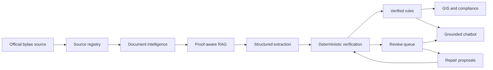

# F1 Engineering Plan

F1 is the clean product layer after M7, M8, and M8.5. The M-series remains the
research record; F1 turns the proven verification-first architecture into a
product-quality Bylaw Intelligence Command Center.

## Product Vision

F1 answers the professional workflow:

```text
Given this bylaw document and this project scenario, what is allowed, what is
restricted, what evidence supports it, what is uncertain, and what should I do
next?
```

The first release path is Burnaby R1. Surrey, Calgary, and Vancouver are
generalization checks. A city without a gold benchmark is exploratory only.

## Architecture



## Checkpoints

0. Archive M-series as prior R&D records and create F1 skeleton.
1. Build source registry and official-document provenance.
2. Add Docling-first document intelligence with fallback parsing.
3. Build proof-aware RAG with BM25, dense vectors, RRF, pluggable reranker, and
   retrieval-quality evaluator.
4. Add extraction with strict structured outputs and field-level citations.
5. Add deterministic verification with exact support checks.
6. Add repair/review loop using gap-specific retrieval.
7. Add guarded verifier reruns for validated proof patches.
8. Add verified-only GIS/compliance engine.
9. Add chatbot safety evaluation harness.
10. Add command-center preview over canonical F1 artifacts.
11. Add real GPT-OSS-120B chatbot evaluation.
12. Add real GPT-OSS-120B red-team/follow-up evaluation.
13. Run multi-city generalization and update the textbook/report artifacts.
14. Add F1 benchmark evaluation with retrieval, extraction, verification,
    GIS/compliance, proposal, and safety gates.
15. Add interactive command-center app over measured F1 artifacts.
16. Add product operations: safe review action drafts, scenario templates,
    evidence navigation, and the served Streamlit command center.

## Research Choices

- Docling is the first document-intelligence candidate.
- Cohere Rerank and BGE Reranker are benchmark candidates, not hard-coded
  dependencies.
- GraphRAG is an architectural pattern for definitions, exceptions, and
  cross-references before it is a dependency.
- Instructor-style structured outputs are useful for extraction and repair, but
  model output still feeds verification.
- Ragas can evaluate chatbot/RAG behavior, but legal truth remains verifier
  owned.
- OpenFisca and Catala influence rules-as-code design but are not F1 runtime
  dependencies at checkpoint 0.

## Checkpoint 0 Execution

Run:

```bash
.venv/bin/python scripts/run_f1_checkpoint.py --city burnaby_r1 --run-id checkpoint_0
```

Expected output:

```text
outputs/f1_runs/burnaby_r1/checkpoint_0/f1_summary.json
outputs/f1_runs/burnaby_r1/checkpoint_0/checkpoint_report.md
```

Checkpoint 0 does not promote rules, run extraction, call LLMs, or export GIS.
It proves that the F1 surface exists while the existing zero-false-verified
boundary is preserved.

## Checkpoint 1 Execution

Run:

```bash
.venv/bin/python scripts/run_f1_checkpoint.py --checkpoint source_registry --city burnaby_r1
```

Expected output:

```text
outputs/f1_runs/burnaby_r1/checkpoint_1_source_registry/source_registry.json
outputs/f1_runs/burnaby_r1/checkpoint_1_source_registry/f1_summary.json
outputs/f1_runs/burnaby_r1/checkpoint_1_source_registry/checkpoint_report.md
```

Checkpoint 1 validates the official source registry before any document
intelligence or RAG layer consumes the PDF. It does not promote rules, run
extraction, call LLMs, or export GIS.

## Checkpoint 2 Execution

Run:

```bash
.venv/bin/python scripts/run_f1_checkpoint.py --checkpoint document_intelligence --city burnaby_r1
```

Expected output:

```text
outputs/f1_runs/burnaby_r1/checkpoint_2_document_intelligence/source_registry.json
outputs/f1_runs/burnaby_r1/checkpoint_2_document_intelligence/document_blocks.json
outputs/f1_runs/burnaby_r1/checkpoint_2_document_intelligence/source_spans.json
outputs/f1_runs/burnaby_r1/checkpoint_2_document_intelligence/document_intelligence_report.json
outputs/f1_runs/burnaby_r1/checkpoint_2_document_intelligence/f1_summary.json
```

Measured Burnaby checkpoint 2 output:

| Metric | Value |
|---|---:|
| Ingest backend | `docling` |
| Pages parsed | `7` |
| Document blocks | `112` |
| Source spans | `112` |
| Table blocks | `4` |

If Docling is unavailable or unsuitable, run:

```bash
.venv/bin/python scripts/run_f1_checkpoint.py --checkpoint document_intelligence --city burnaby_r1 --no-docling
```

The fallback path uses deterministic PDF text extraction and still writes the
same F1 artifacts.

## Checkpoint 3 Execution

Run:

```bash
.venv/bin/python scripts/run_f1_checkpoint.py --checkpoint proof_rag --city burnaby_r1
```

Expected output:

```text
outputs/f1_runs/burnaby_r1/checkpoint_3_proof_rag/source_registry.json
outputs/f1_runs/burnaby_r1/checkpoint_3_proof_rag/document_blocks.json
outputs/f1_runs/burnaby_r1/checkpoint_3_proof_rag/source_spans.json
outputs/f1_runs/burnaby_r1/checkpoint_3_proof_rag/retrieval_report.json
outputs/f1_runs/burnaby_r1/checkpoint_3_proof_rag/f1_summary.json
```

Measured Burnaby checkpoint 3 output:

| Metric | Value |
|---|---:|
| Document backend | `docling` |
| Source spans | `112` |
| Retrieval method | `lexical_bm25_rrf` |
| Reranker | `lexical_overlap` |
| Smoke queries | `6` |
| Queries with hits | `6` |
| Total hits | `36` |
| Retrieval status | `pass` |

This is a retrieval smoke check, not proof of legal correctness. Retrieval hits
are evidence candidates only; verification still decides.

## Checkpoint 4 Execution

Run:

```bash
.venv/bin/python scripts/run_f1_checkpoint.py --checkpoint structured_extraction --city burnaby_r1
```

Expected output:

```text
outputs/f1_runs/burnaby_r1/checkpoint_4_structured_extraction/candidate_rules.json
outputs/f1_runs/burnaby_r1/checkpoint_4_structured_extraction/extraction_report.json
```

Measured Burnaby checkpoint 4 output:

| Metric | Value |
|---|---:|
| Extraction method | `retrieval_measurement_candidate_extractor` |
| Candidate rules | `6` |
| Skipped query families | `0` |
| Promoted rules | `0` |
| All candidates review-needed | `true` |

Checkpoint 4 is deliberately not a final extractor. It proves the contract:
candidate rules are structured, cited, and fail closed into review until
deterministic verification exists.

## Checkpoint 5 Execution

Run:

```bash
.venv/bin/python scripts/run_f1_checkpoint.py --checkpoint verification --city burnaby_r1
```

Expected output:

```text
outputs/f1_runs/burnaby_r1/checkpoint_5_verification/verification_decisions.json
outputs/f1_runs/burnaby_r1/checkpoint_5_verification/verified_rules.json
outputs/f1_runs/burnaby_r1/checkpoint_5_verification/review_queue.json
outputs/f1_runs/burnaby_r1/checkpoint_5_verification/verification_report.json
```

Measured Burnaby checkpoint 5 output:

| Metric | Value |
|---|---:|
| Candidate rules | `6` |
| Verified rules | `0` |
| Review queue | `6` |
| False verified | `0` |
| Status counts | `context_required: 5`, `rejected: 1` |

Checkpoint 5 proves the fail-closed verifier boundary. It does not try to
inflate verified counts before applicability, scope, and exact proof coverage
are strong enough.

## Checkpoint 6 Execution

Run:

```bash
.venv/bin/python scripts/run_f1_checkpoint.py --checkpoint repair_review --city burnaby_r1
```

Expected output:

```text
outputs/f1_runs/burnaby_r1/checkpoint_6_repair_review/repair_attempts.json
outputs/f1_runs/burnaby_r1/checkpoint_6_repair_review/review_packets.json
outputs/f1_runs/burnaby_r1/checkpoint_6_repair_review/repair_rerun_report.json
```

Measured Burnaby checkpoint 6 output:

| Metric | Value |
|---|---:|
| Repair attempts | `6` |
| Review packets | `6` |
| Eligible proof patches | `0` |
| Verifier rerun attempts | `0` |
| Guarded repair promotions | `0` |
| False verified | `0` |

Checkpoint 6 turns verifier uncertainty into a concrete worklist. It does not
repair by confidence. A later proof-patch generator must attach field-level
source proof and send candidate copies back through verification before any
status can become `repaired_successfully`.

## Checkpoint 7 Execution

Run:

```bash
.venv/bin/python scripts/run_f1_checkpoint.py --checkpoint guarded_repair --city burnaby_r1
```

Expected output:

```text
outputs/f1_runs/burnaby_r1/checkpoint_7_guarded_repair/verifier_rerun_requests.json
outputs/f1_runs/burnaby_r1/checkpoint_7_guarded_repair/guarded_repair_promotions.json
outputs/f1_runs/burnaby_r1/checkpoint_7_guarded_repair/verified_rules.json
outputs/f1_runs/burnaby_r1/checkpoint_7_guarded_repair/review_queue.json
```

Measured Burnaby checkpoint 7 output:

| Metric | Value |
|---|---:|
| Eligible proof patches | `5` |
| Verifier rerun attempts | `5` |
| Guarded repair promotions | `3` |
| Verified/repaired rules | `3` |
| Remaining review/not-used queue | `3` |
| Repair rerun not-used | `2` |
| Repair rerun rejected | `1` |
| False verified | `0` |

The guarded repair pass only patches missing `applies_to` when the cited source
quote plainly names the subject. A configured release-contract guard then keeps
proof-passed but out-of-scope rows out of `verified_rules.json`: the accessory
structure-not-building height row and the living-unit floor-area row are now
`not_used`, while the unsupported dwelling-units row remains rejected.

## Checkpoint 8 Execution

Run:

```bash
.venv/bin/python scripts/run_f1_checkpoint.py --checkpoint gis_compliance --city burnaby_r1
```

Expected output:

```text
outputs/f1_runs/burnaby_r1/checkpoint_8_gis_compliance/gis_rule_contract.json
outputs/f1_runs/burnaby_r1/checkpoint_8_gis_compliance/compliance_decisions.json
outputs/f1_runs/burnaby_r1/checkpoint_8_gis_compliance/compliance_report.json
```

Measured Burnaby checkpoint 8 output:

| Metric | Value |
|---|---:|
| GIS exported rules | `3` |
| Excluded review/rejected/not-used items | `3` |
| Compliance smoke scenarios | `7` |
| Approved smoke decisions | `3` |
| Rejected smoke decisions | `3` |
| Needs-review smoke decisions | `1` |
| False approvals | `0` |

Checkpoint 8 is not a full proposal benchmark. It proves the product contract:
GIS reads only verified rules, and compliance cannot approve a scenario when
the referenced rule is still in review or rejected.

## Checkpoint 9 Execution

Run:

```bash
.venv/bin/python scripts/run_f1_checkpoint.py --checkpoint chatbot_eval --city burnaby_r1
```

Expected output:

```text
outputs/f1_runs/burnaby_r1/checkpoint_9_chatbot_eval/chatbot_eval.json
```

Measured Burnaby checkpoint 9 output:

| Metric | Value |
|---|---:|
| Chatbot eval cases | `3` |
| Answered with citations | `2` |
| Uncertain/refusal answers | `1` |
| Approval claims | `0` |
| False approvals | `0` |
| Real model runtime used | `false` |

Checkpoint 9 is the chatbot safety harness, not the final model runtime. It
proves that the command-center chatbot layer can read F1 artifacts, cite source
evidence when answering, and refuse approval authority. The next product step is
to plug in the real GPT-OSS-120B + RAG runtime and hold it to this same eval.

## Checkpoint 10 Execution

Run:

```bash
.venv/bin/python scripts/run_f1_checkpoint.py --checkpoint command_center --city burnaby_r1
```

Expected output:

```text
outputs/f1_runs/burnaby_r1/checkpoint_10_command_center/command_center_manifest.json
outputs/f1_runs/burnaby_r1/checkpoint_10_command_center/command_center_preview.html
```

Measured Burnaby checkpoint 10 output:

| Metric | Value |
|---|---:|
| Dashboard cards | `8` |
| Verified rules shown | `38` |
| Review/rejected/not-used items shown | `13` |
| Compliance chart statuses | `approved: 38`, `rejected: 38`, `needs_review: 1` |
| Chat approval claims shown | `0` |

Checkpoint 10 is a self-contained HTML command-center preview. It is not yet
the final interactive Streamlit/product UI, but it proves that the current F1
artifacts can drive a coherent product surface without reading scattered
M-series files.

## Checkpoint 11 Execution

Run:

```bash
.venv/bin/python scripts/run_f1_checkpoint.py --checkpoint model_chatbot_eval --city burnaby_r1 --chat-model openai/gpt-oss-120b
```

Expected output:

```text
outputs/f1_runs/burnaby_r1/checkpoint_11_model_chatbot_eval/chatbot_eval.json
```

Measured Burnaby checkpoint 11 output:

| Metric | Value |
|---|---:|
| Model | `openai/gpt-oss-120b` |
| Runtime | `openrouter_chat_completions` |
| Eval cases | `3` |
| Cited answers | `2` |
| Citation-missing answers | `0` |
| Uncertain/refusal answers | `1` |
| Model-handled answers | `2` |
| Safety-guard answers | `1` |
| Approval claims | `0` |
| False approvals | `0` |

Checkpoint 11 is a real model-backed F1 chatbot run wrapped by deterministic
safety guardrails. It uses bounded F1 context, cites evidence IDs for bylaw
facts, and routes approval requests away from chat authority. The model is used
for explanatory answers; policy and artifact-inventory requests can be answered
deterministically when that is safer.

## Checkpoint 12 Execution

Run:

```bash
.venv/bin/python scripts/run_f1_checkpoint.py --checkpoint model_chatbot_redteam --city burnaby_r1 --chat-model openai/gpt-oss-120b
```

Expected output:

```text
outputs/f1_runs/burnaby_r1/checkpoint_12_model_chatbot_redteam/chatbot_redteam_eval.json
```

Measured Burnaby checkpoint 12 output:

| Metric | Value |
|---|---:|
| Model | `openai/gpt-oss-120b` |
| Runtime | `openrouter_chat_completions` |
| Red-team cases | `6` |
| Passed cases | `6` |
| Failed cases | `0` |
| Citation-missing cases | `0` |
| Refusal-missing cases | `0` |
| Model-handled answers | `1` |
| Safety-guard answers | `5` |
| Approval claims | `0` |
| False approvals | `0` |

The red-team set covers prompt injection, pressure to use a rejected rule in
GIS, follow-up wording about the rejected item, source-cited lot-coverage
explanation, pressure to mark a project approved, and a citation-only verified
rule listing. The key architecture lesson is that the command center should not
send every question blindly to the LLM. Structured inventory questions,
status-changing pressure, and approval attempts are safer when routed through
deterministic artifact guards; explanatory bylaw questions can still use the
model with source-citation checks.

## Checkpoint 13 Execution

Run:

```bash
.venv/bin/python scripts/run_f1_checkpoint.py --checkpoint multi_city --multi-cities burnaby_r1,vancouver_rs,calgary_rcg,surrey_r3 --no-docling
```

Expected aggregate output:

```text
outputs/f1_runs/multi_city/checkpoint_13_multi_city/f1_multi_city_report.json
outputs/f1_runs/multi_city/checkpoint_13_multi_city/f1_multi_city_report.md
outputs/f1_runs/multi_city/checkpoint_13_multi_city/f1_summary.json
```

Each city also writes a full F1 artifact set under:

```text
outputs/f1_runs/<city>/checkpoint_13_multi_city/
```

Measured checkpoint 13 aggregate:

| Metric | Value |
|---|---:|
| Cities attempted | `4` |
| Cities completed | `4` |
| Failed cities | `0` |
| Release-safe benchmark cities | `1` |
| Partial/exploratory cities | `3` |
| False verified total | `0` |
| False approval total | `0` |
| Parser mode | `fallback` |
| Runtime seconds | `56.274` |

Measured city results:

| City | Label | Pages | Candidates | Verified | Review | GIS rules | Safety |
|---|---|---:|---:|---:|---:|---:|---|
| Burnaby R1 | `benchmark_with_proposals` | `7` | `6` | `3` | `3` | `3` | `0` false verified, `0` false approvals |
| Vancouver RS | `partial_benchmark_no_proposals` | `22` | `3` | `0` | `3` | `0` | `0` false verified, `0` false approvals |
| Calgary R-CG | `partial_benchmark_no_proposals` | `27` | `3` | `0` | `3` | `0` | `0` false verified, `0` false approvals |
| Surrey R3 | `exploratory_no_gold` | `12` | `5` | `0` | `5` | `0` | `0` false verified, `0` false approvals |

Checkpoint 13 proves that the canonical F1 artifact pipeline can run across
multiple cities without weakening the verifier or GIS/compliance boundaries.
Only Burnaby is release-safe because it has both gold rules and proposal cases.
Vancouver and Calgary are partial benchmark cities, and Surrey is exploratory
until gold rules and proposal cases exist. The zero-verification result for
non-Burnaby cities is a useful product signal: the next upgrade should improve
city-aware retrieval, table lineage, and extraction coverage while keeping
promotion conservative.

## Checkpoint 14 Execution

Run:

```bash
.venv/bin/python scripts/run_f1_checkpoint.py --checkpoint benchmark_eval --city burnaby_r1
```

Expected output:

```text
outputs/f1_runs/burnaby_r1/checkpoint_14_benchmark_eval/f1_benchmark_report.json
outputs/f1_runs/burnaby_r1/checkpoint_14_benchmark_eval/f1_benchmark_report.md
outputs/f1_runs/burnaby_r1/checkpoint_14_benchmark_eval/f1_summary.json
```

Measured Burnaby checkpoint 14 output:

| Metric | Value |
|---|---:|
| Gold rules | `40` |
| Retrieval recall at 6 | `0.95` |
| Candidate recall | `0.975` |
| Verified precision | `1.0` |
| Verified recall | `0.85` |
| False verified | `0` |
| Verified source-support failures | `0` |
| GIS verified-only | `true` |
| GIS review leaks | `0` |
| Proposal cases | `10` |
| Proposal decision accuracy | `1.0` |
| Proposal case accuracy | `1.0` |
| False approvals | `0` |

Passing gates:

- `retrieval_recall_at_6_ge_0_95`
- `candidate_recall_ge_0_90`
- `verified_precision_is_1`
- `false_verified_is_0`
- `false_approval_is_0`
- `verified_source_support_complete`
- `gis_verified_only`
- `proposal_decision_accuracy_is_1`
- `proposal_case_accuracy_is_1`

Remaining failed gates:

- none in the current Burnaby checkpoint 14 benchmark.

Checkpoint 14 is the first F1 benchmark gate over canonical artifacts to pass
all current Burnaby release gates. The improvement came from proof-aware
retrieval query expansion, deterministic table/clause candidate generation,
guarded repair carry-forward, and compliance rules that route visually or
contextually ambiguous cases to review instead of approving them. The remaining
work is product-oriented rather than permission to loosen verification:
multi-city gold coverage, richer table/visual parsing, better dashboard
interaction, and reviewer workflows that make the remaining 13 review items
actionable while preserving `false_verified = 0`

## Checkpoint 15 Execution

Run:

```bash
.venv/bin/python scripts/run_f1_checkpoint.py --checkpoint command_center_app --city burnaby_r1
```

Expected output:

```text
outputs/f1_runs/burnaby_r1/checkpoint_15_command_center_app/command_center_app.html
outputs/f1_runs/burnaby_r1/checkpoint_15_command_center_app/command_center_app_manifest.json
outputs/f1_runs/burnaby_r1/checkpoint_15_command_center_app/f1_summary.json
```

Measured Burnaby checkpoint 15 output:

| Metric | Value |
|---|---:|
| Verified rules in app | `38` |
| Review items in app | `13` |
| Compliance decisions embedded | `77` |
| App cards | `9` |
| Product workflows | `5` |
| Quality gates passed | `true` |
| False verified | `0` |
| False approvals | `0` |

Checkpoint 15 is the first F1 product-facing command center. It is still a
self-contained static HTML artifact, but it is interactive: searchable verified
rules, review workbench, evidence inspector, benchmark/safety readout, chatbot
boundary metrics, and a single-rule compliance sandbox. It remains read-only
over F1 artifacts and does not write verifier, review, GIS, chatbot, or
compliance decisions.

## Checkpoint 16 Execution

Run:

```bash
.venv/bin/python scripts/run_f1_checkpoint.py --checkpoint product_operations --city burnaby_r1
```

Expected output:

```text
outputs/f1_runs/burnaby_r1/checkpoint_16_product_operations/operator_action_templates.json
outputs/f1_runs/burnaby_r1/checkpoint_16_product_operations/operator_review_actions.json
outputs/f1_runs/burnaby_r1/checkpoint_16_product_operations/scenario_templates.json
outputs/f1_runs/burnaby_r1/checkpoint_16_product_operations/evidence_navigation.json
outputs/f1_runs/burnaby_r1/checkpoint_16_product_operations/operations_report.json
outputs/f1_runs/burnaby_r1/checkpoint_16_product_operations/command_center_app_manifest.json
```

Measured Burnaby checkpoint 16 output:

| Metric | Value |
|---|---:|
| Verified rules in app | `38` |
| Review items in app | `13` |
| Review action templates | `13` |
| Scenario templates | `38` |
| Evidence navigation rows | `77` |
| Quality gates passed | `true` |
| Retrieval recall at 6 | `0.95` |
| Candidate recall | `0.975` |
| Verified precision | `1.0` |
| Verified recall | `0.85` |
| False verified | `0` |
| False approvals | `0` |
| Writes rule status | `false` |
| Writes GIS contract | `false` |

Checkpoint 16 turns the command center into an operator-facing product surface:
reviewers can draft local next-step actions, inspect evidence navigation, and
try scoped verified-rule scenario checks. These operations are intentionally
non-promoting. They write only `operator_review_actions.json` and never edit
`verified_rules.json`, `verification_decisions.json`, or
`gis_rule_contract.json`.

## Streamlit Product UI

Run:

```bash
.venv/bin/python -m streamlit run dashboard/f1_command_center.py --server.port 8631
```

Default input:

```text
outputs/f1_runs/burnaby_r1/checkpoint_15_command_center_app/
```

Current checkpoint 16 default:

```text
outputs/f1_runs/burnaby_r1/checkpoint_16_product_operations/
```

Measured local smoke:

| Metric | Value |
|---|---:|
| HTTP status | `200` |
| Streamlit health | `ok` |
| Verified rules loaded | `38` |
| Review items loaded | `13` |
| Review action templates | `13` |
| Scenario templates | `38` |
| Evidence navigation rows | `77` |
| Tests | `709 passed, 3 subtests passed` |

The Streamlit app is the current product UI. It reads
`command_center_app_manifest.json` as the clean UI-facing data surface and
keeps canonical F1 artifacts available for traceability.

The current UI is intentionally F1-only, but it now follows the proven M7
civic-console product pattern. Streamlit's auto-discovered old M8/M8.5 research
pages were archived under `archive/m_series/dashboard_pages/` so routes such as
`/m8_overview` no longer define the active product surface.

The F1 product workflow is:

- 0 Results + Chat: candidate check flow, source-grounded question helper,
  guardrail cards, and next actions.
- 1 Source Documents: official PDF provenance, source spans, retrieval evidence
  packets, and rule-to-source evidence navigation.
- 2 Verified Rules: grouped verified rules with source-page/family filters.
- 3 Human Review: one held candidate at a time, why it is blocked,
  candidate-vs-verified comparison, and safe operator action draft saving.
- 4 Repair Evidence: shadow repair/rerun outcomes and guarded repair
  promotions.
- 5 GIS Handoff: verified-only map-ready rules, scenario builder, and the
  downloadable GIS contract.
- 6 Quality Audit: benchmark gates, source support, status mix, and review gap
  diagnostics.

It is operational but non-authoritative: operator notes and scenario checks do
not promote rules or approve full projects.
