# M8 Technical Handoff Report

Date: 2026-06-29  
Scope: `burnaby_r1` M8 local run  
Primary run: `outputs/m8_runs/burnaby_r1/local_m8`

## Executive Summary

M8 is an additive layer beside M7. It does not replace deterministic verification. It gives the system stronger structure around evidence, retrieval, repair, analytics, dashboard inspection, and chatbot analysis while preserving the original safety rule:

```text
Extraction proposes.
Retrieval finds missing context.
Repair patches weak candidates.
Verification proves or rejects.
Dashboard explains.
Chatbot analyzes.
GIS consumes only verified rules.
```

Measured current M8 outcome:

| Metric | Value |
|---|---:|
| Structured rules | 144 |
| Verified | 85 |
| Repaired successfully | 2 |
| Verified-like total | 87 |
| Review needed | 48 |
| Context required | 9 |
| Rejected | 0 |
| False verified | 0 |
| False approvals | 0 |
| Repair attempts | 171 |
| M8 chatbot gold | 3/3 |
| M7 safety preserved | true |
| Release check | passed |

## Figma Flowchart

Editable FigJam flowchart:

https://www.figma.com/board/9bs5W81bQXW0Ite5cDo5Pj?utm_source=codex&utm_content=edit_in_figjam&oai_id=&request_id=6164171a-57f3-42e0-887f-4813d098c594

## System Flow

```mermaid
flowchart LR
    subgraph inputs ["Current Inputs"]
        m7Artifacts["M7 artifacts: evidence units, verified rules, review queue, benchmark"]
        cityConfig["City config: Burnaby R1"]
    end

    subgraph core ["M8 Additive Core"]
        sourceSpans["SourceSpan store"]
        structuredContracts["StructuredRule and field evidence pointers"]
        hybridRetrieval["Hybrid retrieval index"]
        repairLoop["Bounded repair loop"]
        m8Verifier["M8 verifier wrapper"]
        m8Analytics["M7 vs M8 analytics"]
    end

    subgraph safety ["Safety Boundary"]
        deterministicVerifier{{"M7 deterministic verifier remains authority"}}
        verifiedOnly["Verified-only GIS contract"]
    end

    subgraph surfaces ["Worker and Reader Surfaces"]
        artifactStore["M8 JSON artifact store"]
        dashboardPages["Streamlit M8 pages"]
        analyticChatbot["Artifact-backed analytic chatbot"]
        releaseCheck["M8 release check"]
    end

    subgraph frontier ["M8.5 Frontier"]
        tableLineage["Table lineage"]
        dependencyGraph["Legal dependency graph"]
        reviewerPackets["Reviewer workbench packets"]
    end

    m7Artifacts -->|"Ingested as source spans"| sourceSpans
    cityConfig -->|"Loads city scope"| structuredContracts
    sourceSpans -->|"Anchors evidence"| structuredContracts
    structuredContracts -->|"Weak candidates"| hybridRetrieval
    hybridRetrieval -->|"Evidence bundles"| repairLoop
    repairLoop -->|"Candidate copy only"| deterministicVerifier
    deterministicVerifier -->|"Accepted or held"| m8Verifier
    repairLoop -.->|"Cannot promote directly"| m8Verifier
    m8Verifier -->|"Status separation"| m8Analytics
    m8Verifier -->|"Verified-like only"| verifiedOnly
    m8Analytics -->|"Summary and comparison"| artifactStore
    artifactStore -->|"Feeds"| dashboardPages
    artifactStore -->|"Feeds"| analyticChatbot
    artifactStore -->|"Validated by"| releaseCheck
    artifactStore -.->|"Next upgrade input"| tableLineage
    tableLineage --> dependencyGraph
    dependencyGraph --> reviewerPackets
```



## Layer Responsibilities

| Layer | Key files | Input | Output sent next |
|---|---|---|---|
| Ingestion | `src/burnaby_prototype/m8/ingestion/source_blocks.py`, `source_span_store.py` | M7 evidence units and source text | `source_spans.json` for contracts and retrieval |
| Contracts | `src/burnaby_prototype/m8/extraction/rule_schema.py` | Source spans and M7 rule rows | `StructuredRule`, `EvidencePointer`, `VerificationDecision`, `M8RunSummary` records |
| Decomposition | `src/burnaby_prototype/m8/extraction/rule_decomposer.py` | M7 verified/review/rejected rows | `structured_rules.json` with normalized rule fields |
| Retrieval | `src/burnaby_prototype/m8/retrieval/hybrid_index.py`, `query_planner.py`, `evidence_bundle.py` | Source spans plus repair/search query | `evidence_bundles.json` for repair and audit |
| Repair | `src/burnaby_prototype/m8/repair/repair_loop.py` | Review/context candidates and retrieved evidence | `repair_attempts.json`; candidate copies sent back to verifier |
| Verification wrapper | `src/burnaby_prototype/m8/verification/m8_verifier.py` | Structured rule or candidate copy | `verification_decisions.json` and `verification_report.json` |
| Analytics | `src/burnaby_prototype/m8/analytics/m7_m8_compare.py`, `coverage_metrics.py`, `repair_metrics.py` | M7 benchmark, M8 decisions, repair attempts | `m7_m8_comparison.json`, `m8_summary.json` |
| Dashboard | `dashboard/m8_data.py`, `dashboard/pages/m8_*.py` | M8 JSON artifacts | Reader-facing overview, rule explorer, repair inspector, benchmark comparison |
| Chatbot | `src/burnaby_prototype/m8/chatbot/analyst_tools.py` | `m8_chatbot_context.json` | Artifact-backed answers with citations and refusal behavior |

## Safety Boundary

M8 must not be read as a new legal authority. It is a structured control layer around M7.

| Boundary | Rule |
|---|---|
| Repair | Can generate patches only on candidate copies. It cannot promote directly. |
| Verification | Existing M7 deterministic verification remains authoritative. |
| Dependency status | Unresolved legal context becomes `context_required`, not `verified`. |
| Dashboard | Reads generated artifacts; it does not rewrite verifier decisions. |
| Chatbot | Answers from artifacts; it must not mutate rules or invent approvals. |
| GIS | Consumes verified-like rules only. |

## Current Artifacts

| Artifact | Purpose |
|---|---|
| `source_spans.json` | Source-level evidence spans derived from M7 evidence units |
| `structured_rules.json` | Normalized M8 rule contracts with evidence pointers |
| `verification_decisions.json` | Per-rule status, reason, gaps, dependencies, and repair history |
| `repair_attempts.json` | Audit trail of bounded repair attempts |
| `evidence_bundles.json` | Retrieved supporting evidence bundles |
| `verification_report.json` | Status counts and unresolved dependency counts |
| `m7_m8_comparison.json` | M7-vs-M8 metrics and safety checks |
| `m8_summary.json` | Run-level summary for dashboards and release review |
| `m8_chatbot_context.json` | Consolidated context for artifact-backed chatbot answers |
| `m8_chatbot_eval.json` | M8 chatbot gold-case result |

## Results Interpretation

M8 did not increase legal risk. The important result is not just that M8 has more surfaces; it preserved the zero-false-verified invariant.

| Status | Meaning | Current count |
|---|---|---:|
| `verified` | Accepted by deterministic checks without unresolved M8 blockers | 85 |
| `repaired_successfully` | Accepted after guarded, verifier-backed repair provenance | 2 |
| `context_required` | Scalar evidence may exist but legal dependency/context is unresolved | 9 |
| `review_needed` | Still needs human/legal or evidence review | 48 |
| `rejected` | Contradicted or failed critical checks | 0 |

M8 reduced generic review pressure by separating 9 items into `context_required`, which is more actionable than a flat review bucket.

## Known Gaps

| Gap | Why it matters | M8.5 direction |
|---|---|---|
| Table structure is still too lossy | Row, column, blank-cell, and footnote evidence can change legal meaning | Add table lineage and table-derived candidate artifacts |
| Dependencies are only partially represented | Definitions, exceptions, overlays, and cross-references affect whether a rule is complete | Add a legal dependency graph |
| Repair loop is conservative | 171 attempts produced no new M8-loop-generated verifier wins | Add better repair evaluation and reviewer packet workflow |
| Review work is not yet first-class enough | Human decisions need structured packets and verifier rerun requests | Add reviewer workbench artifacts |

## Worker Instructions

Start here:

```bash
.venv/bin/python scripts/run_m8_release_check.py
.venv/bin/python scripts/run_m8_pipeline.py --city burnaby_r1 --config configs/burnaby_r1.json --input-dir outputs/m7_runs/burnaby_r1/google_gemini_3_1_flash_lite --output-dir outputs/m8_runs/burnaby_r1/local_m8 --max-repair-attempts 3 --dry-run
```

Debug in this order:

1. `source_spans.json`
2. `structured_rules.json`
3. `verification_decisions.json`
4. `repair_attempts.json`
5. `m7_m8_comparison.json`
6. `m8_summary.json`

Do not promote a rule because retrieval, repair, dashboard, chatbot, or model confidence looks persuasive. Promotion must flow through the deterministic verifier.

